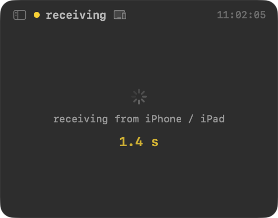
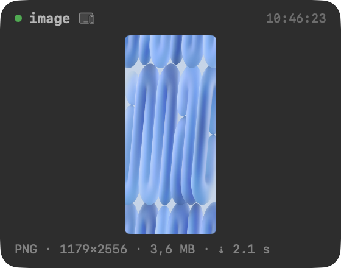
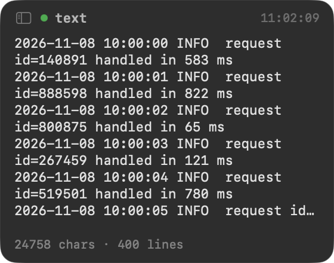
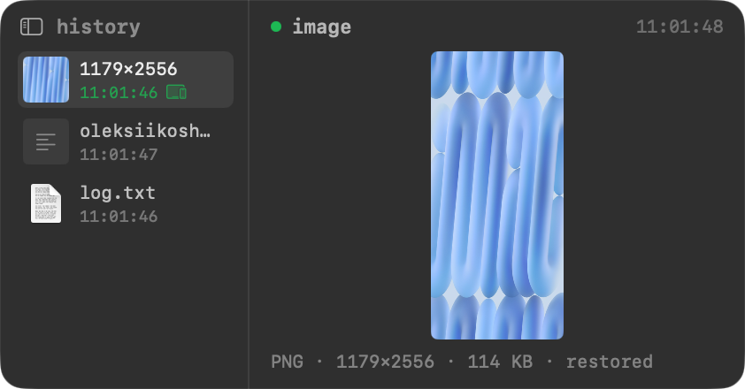

# Simple Paste Monitor

A tiny always-on-top macOS window that shows what is on the clipboard — the picture itself, the head of the text, the files — the moment it arrives. Made for watching screenshots come over from iPhone and iPad via Universal Clipboard, where pasting often lags and you want to *see* that it has landed.

## Screenshots

| Receiving from iPhone | Arrived | Text | History |
|------|--------|------|------|
|  |  |  |  |

## Download

**[Download SimplePasteMonitor.dmg](https://github.com/lexey111/SimplePasteMonitor/releases/latest/download/SimplePasteMonitor-1.3.0.dmg)**

### Install

1. Open the DMG and drag **SimplePasteMonitor** to **Applications**
2. **The app is not notarized**, so macOS will block it on first launch:
   - Open **System Settings → Privacy & Security**, scroll to the Security section and click **Open Anyway** next to SimplePasteMonitor
   - Or: right-click the app in Applications → **Open** → **Open**
3. **If macOS asks about clipboard access** — since 15.4 it can, depending on settings, before an app reads what other apps copied. A monitor reads on every copy, so "Ask" would mean a dialog each time:
   - **System Settings → Privacy & Security → Paste from Other Apps** → set **SimplePasteMonitor** to **Allow**
   - While the setting is "Ask" the widget shows a yellow *macOS asks on every copy* line with a shortcut to that page; the menu bar icon has it too (**Clipboard Privacy Settings…**). If access is denied, the widget says so
   - If System Settings offers to quit and reopen the app after the change, accept

> The app is ad-hoc signed. After installing a new version macOS may treat it as a new app and ask for clipboard access again.

## Features

- **Images, shown** — screenshots from iPhone/iPad (HEIC, PNG, JPEG, …) are drawn directly, whichever representation the sender put first. No switching to `public.png` by hand
- **Arrival you can see** — Universal Clipboard sends only the list of types at first and the bytes on demand. The widget asks for them at once and shows *receiving from iPhone / iPad* with a running timer, then the picture and how long it took (`⇣ 2.3 s`)
- **Sound on arrival** — optional; any system sound, picked from the menu bar. It plays when the content is here, not when it was announced
- **Text** — the head of it, cut with an ellipsis where the window ends, plus character and line counts
- **Files** — names, icons and sizes; a single copied image file is shown as the image
- **Everything else** — the list of pasteboard types
- **History of the last five** — the sidebar button (or **Show History** in the menu) opens the last five clipboards; a click puts one back. Two clicks when what's on the clipboard now isn't in history itself — a password, a type history can't hold — so a slip of the mouse can't lose it; the row asks *replace? click again*. For the screenshot that arrived and then got overwritten by a stray auto-copy in a terminal. The original bytes go back, plus a PNG when they were HEIC — plenty of apps take nothing else. Kept in memory only, never on disk, and concealed items never enter it
- **Passwords stay hidden** — items marked concealed by password managers (the [nspasteboard.org](http://nspasteboard.org) convention) are never read, only reported as concealed
- **Source app** — when the sender says who it is
- **Light and dark** — follows macOS, or pinned to either under **Appearance** in the menu bar; the light theme has its own darker accents, so the yellow and orange states stay readable
- **Floating, resizable, remembered** — stays above other windows on all Spaces; drag it anywhere, resize from any edge, position and size survive restarts. **Reset Widget Position** in the menu brings it back if a display goes away

## How It Works

macOS has no notification for clipboard changes, so the app polls `NSPasteboard.changeCount` four times a second — a cheap integer read. On a change it reads only the one representation it is going to draw, on a background thread: reading a Universal Clipboard item blocks until the phone has sent it, and asking for every type would make the sender render all of them.

## Building

- macOS 15.4+, Xcode 26+
- Open `SimplePasteMonitor.xcodeproj`, build and run
- `./scripts/build-release.sh 1.3.0` builds a Release `.app` and packs it into `build/SimplePasteMonitor-1.3.0.dmg`

Setting `SPM_PASTEBOARD=<name>` in the environment makes the app watch a private named pasteboard instead of the system one — handy for testing without touching your clipboard (and without the privacy prompt, which guards only the system pasteboard).
